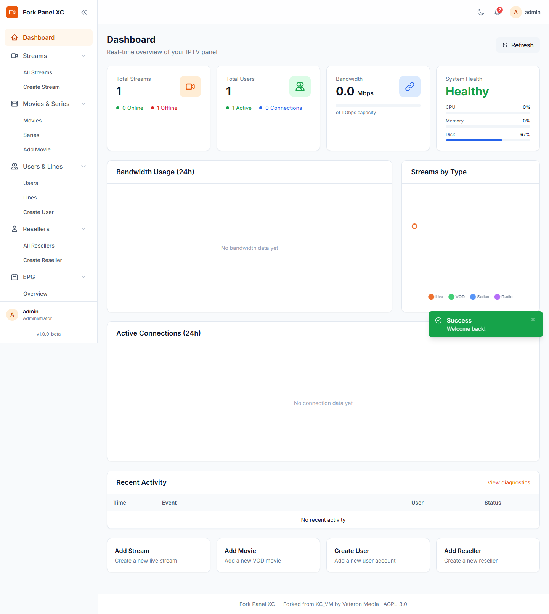
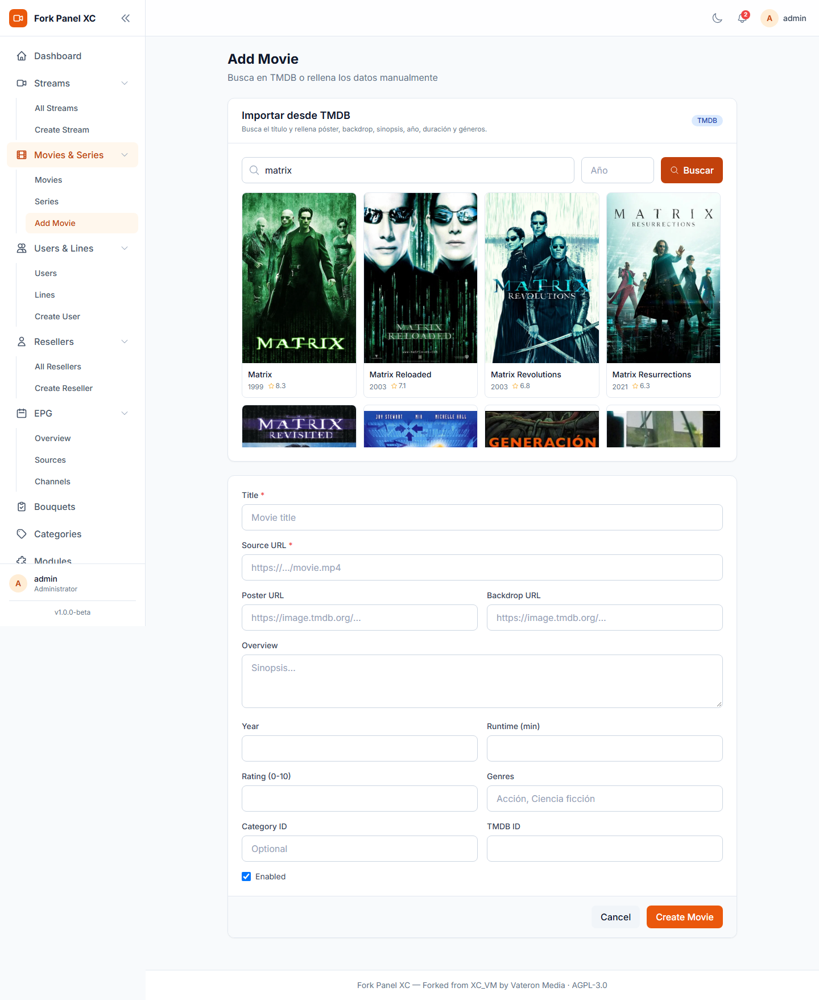
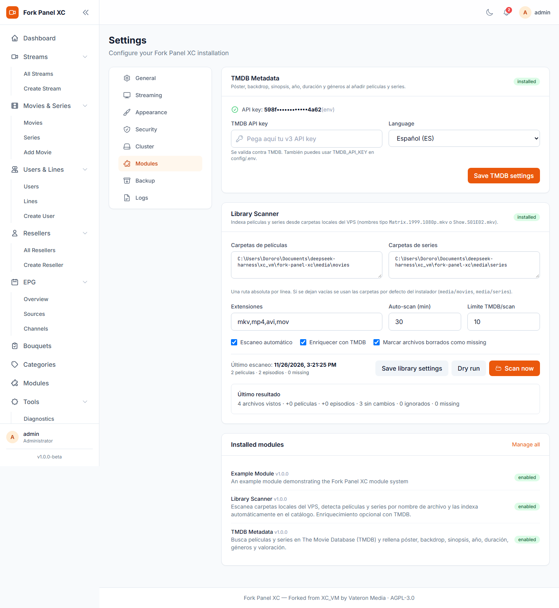

<p align="center">
  
</p>

<h1 align="center">Fork Panel XC</h1>
<p align="center">
  <b>Open-source, community-driven IPTV panel forked from XC_VM</b><br>
  Modern, modular, API-first architecture with Vue 3 frontend – powerful, scalable, and free.
</p>

<p align="center">
  <a href="LICENSE"></a>
  <a href="https://github.com/TalaveraSama/fork-panel-xc/stargazers"></a>
  <a href="https://github.com/TalaveraSama/fork-panel-xc/issues"></a>
</p>



---

# 📑 Table of Contents

<details>
<summary><strong>📘 Contents</strong></summary>

- 🏁 [Overview](#-overview)
- ⚠️ [Status](#️-status)
- 📚 [Documentation](#-documentation)
- 🔄 [Migration Guide](#-migration-guide)
- 🧱 [Technology Stack](#-technology-stack)
- 🧩 [Supported OS](#-supported-operating-systems)
- 📥 [Quick Install](#-quick-install)
- 🧰 [Service Management](#-service-management)
- 📂 [Project Structure](#-project-structure)
- 🧮 [Server Requirements & Sizing](#-server-requirements--sizing)
- ⭐ [Features](#-features)
- 🐞 [Known Limitations](#-known-limitations)
- 🤝 [Contributing](#-contributing)
- ⚠️ [Legal & Licensing Notice](#️-legal--licensing-notice)
- 📜 [License (AGPL-3.0)](#-license-agpl-30)

</details>

---

## 🚀 Overview

**XC_VM** is an open-source IPTV platform based on Xtream Codes.
It enables:

- 📺 Live & VOD streaming
- 🔀 Load balancing
- 📊 Full user/reseller control
- 🎚️ Transcoding & EPG
- 🔐 Hardened security fixes

> ✅ Free, AGPL-3.0. A single-server panel needs no key; load balancers and the fanout
> daemon need a free activation key — see [Activation key](#activation-key).

---

## ⚠️ Status

> **BETA SOFTWARE** — actively developed

---

## 📚 Documentation

- 🇬🇧 **Docs in the repository**
  [docs/](docs/)

- 🇬🇧 **Fork architecture notes**
  [docs/FORK.md](docs/FORK.md)

- 🇷🇺 **Руководство на русском**
  [docs/ru/](docs/ru/)

---

## 🔄 Migration Guide

Migrating from Xtream Codes / XUI.one / XC_VM? Follow the step-by-step migration guide:

- 📖 **Upstream migration guide**
  [https://vateron-media.github.io/XC_VM/latest/info/migration_guide/](https://vateron-media.github.io/XC_VM/latest/info/migration_guide/)

- 🛠️ **Database migrations in this fork**
  `php console.php db:migrate` (see [docs/FORK.md](docs/FORK.md))

---

## 🧱 Technology Stack

| Component | Version       | Description                                   |
| --------- | ------------- | --------------------------------------------- |
| PHP       | 8.3.36        | Backend runtime (API-first)                   |
| Vue 3     | 3.4+          | Frontend framework (Composition API)          |
| Vite      | 5.0+          | Build tool & dev server                       |
| Pinia     | 2.1+          | State management                              |
| Vue Router| 4.3+          | Routing                                       |
| Tailwind CSS | 3.4+       | Utility-first CSS framework                   |
| Nginx     | 1.24          | Web server & reverse proxy                    |
| FFmpeg    | 8.0, 7.1, 4.0 | Media transcoding & processing                |
| MariaDB   | 11.4          | SQL database engine                           |
| Redis     | OS security package | Cache & session storage                  |
| yt-dlp    | latest        | Resolves YouTube and other platform links     |
| Deno      | latest        | JavaScript runtime yt-dlp needs for YouTube   |

---

## 🐧 Supported Operating Systems

XC_VM supports multiple Linux distributions. Distribution-specific binaries are downloaded automatically during installation: PHP and Nginx from [XC_VM_Binaries](https://github.com/Vateron-Media/XC_VM_Binaries), FFmpeg from [XC_VM_FFMPEG](https://github.com/Vateron-Media/XC_VM_FFMPEG). [yt-dlp](https://github.com/yt-dlp/yt-dlp) is updated daily from its upstream releases, and [Deno](https://deno.com) is installed from its upstream releases when missing.

### Ubuntu

| Version   | Codename        | Status                                                                                     |
| --------- | --------------- | ------------------------------------------------------------------------------------------ |
| **18.04** | Bionic Beaver   | ❌ _Not supported_                                                                          |
| **20.04** | Focal Fossa     | ⚠️ _Outdated_ — installation possible, but some packages may need to be installed manually |
| **22.04** | Jammy Jellyfish | ✅ **Recommended**                                                                         |
| **24.04** | Noble Numbat    | ✅ **Recommended**                                                                         |

### Debian

| Version | Codename | Status             |
| ------- | -------- | ------------------ |
| **12**  | Bookworm | ✅ Supported       |
| **13**  | Trixie   | ✅ **Recommended** |

### RHEL-compatible (Rocky Linux, AlmaLinux, CentOS, RHEL)

| Version | Status                 |
| ------- | ---------------------- |
| **8**   | 🚧 _Not yet supported_ |
| **9**   | 🚧 _Not yet supported_ |

> ⚠️ RHEL-family support is planned but not yet available: there are no pre-built binaries or FFmpeg builds for it, and the installer refuses these distributions.

---

### 💡 Recommendations

For new installations:

- 🟢 **Ubuntu 22.04 / 24.04 LTS**
- 🟢 **Debian 13**

> ⚠️ Ubuntu 18.04 and Debian 11 are not supported: the installer warns on them and asks before going on.

---

## 📥 Quick Install

> ✅ Ubuntu 22.04+, Debian 12+

### Un comando (recomendado)

```bash
curl -fsSL https://raw.githubusercontent.com/TalaveraSama/fork-panel-xc/main/install.sh | sudo bash
```

O desde un clon:

```bash
git clone https://github.com/TalaveraSama/fork-panel-xc.git
cd fork-panel-xc
sudo bash install.sh
```

El instalador detecta la distro, instala nginx/MariaDB/Redis/PHP-FPM, construye
el frontend, crea la base de datos, escribe `config/.env`, configura nginx y los
servicios systemd, aplica las migraciones e imprime la contraseña de `admin`.

Opciones útiles:

```bash
sudo bash install.sh --domain panel.example.com --ssl    # HTTPS con certbot
sudo bash install.sh --admin-password 'MiClaveSegura123' # contraseña fija
sudo bash install.sh --tmdb-api-key 'TU_API_KEY'         # metadatos TMDB
sudo bash install.sh --dir /opt/fork-panel-xc            # otra ruta
sudo bash install.sh --help                              # todas las opciones
```

### Instalador Python (alternativa)

```bash
git clone https://github.com/TalaveraSama/fork-panel-xc.git
cd fork-panel-xc
cd frontend && npm install && npm run build && cd ..
sudo python3 install.py
```

The installer prints the generated admin password and the panel URL. Change the
password after the first sign-in.

### 🐳 Docker (alternative)

```bash
cp .env.example config/.env      # adjust DB/Redis passwords
cd frontend && npm install && npm run build && cd ..
docker compose up -d
docker compose exec php php /home/fork_panel_xc/console.php db:migrate
```

The panel is served at `http://localhost/`.

### 🧪 Development install

```bash
# Backend (needs PHP 8.3 + MariaDB + Redis)
php console.php serve 8080

# Database-free API smoke test (router, JWT, stream tokens)
php tests/api-smoke.php

# Frontend with hot reload (proxies /api to :8080)
cd frontend && npm install && npm run dev
```

> ⚠️ Beta versions may contain unstable features. Use on test servers only.

---

## 🧰 Service Management

```bash
sudo systemctl restart php8.3-fpm        # PHP-FPM (adjust version)
sudo systemctl restart nginx             # Web server
sudo systemctl restart mariadb           # Database
sudo systemctl restart redis-server      # Cache
sudo systemctl restart fork-panel-xc-worker     # Queue worker
sudo systemctl restart fork-panel-xc-scheduler  # Scheduler
sudo -u fork_panel_xc php /home/fork_panel_xc/console.php list
journalctl -u fork-panel-xc-worker -f
```

---

## 🔍 Troubleshooting — Panel Won't Start

Guía detallada de login: [docs/TROUBLESHOOTING-LOGIN.md](docs/TROUBLESHOOTING-LOGIN.md).

### TMDB / metadatos

- Módulo no instalado → `console.php module:install tmdb`.
- `422 TMDB API key is not configured` → configura la key en **Settings → Modules**.
- `502 SSL certificate` → instala `ca-certificates` en el servidor.
- Guía completa: [docs/modules/TMDB.md](docs/modules/TMDB.md).

### Library Scanner

- No detecta archivos → revisa extensiones y nombres (`S01E02` / `1x02`).
- Todo aparece `missing` → alguna carpeta configurada ya no existe.
- Guía completa: [docs/modules/LIBRARY.md](docs/modules/LIBRARY.md).

### Login fails

```bash
# 401 JSON = API OK; 500 = problema de configuración/base de datos
curl -i http://127.0.0.1/api/auth/me

# ¿Puede PHP-FPM leer el .env? Si no, el login devuelve 500
sudo -u www-data test -r /home/fork_panel_xc/config/.env && echo "legible" || echo "NO legible"
```

Arreglo rápido si el `.env` no es legible:

```bash
sudo chgrp www-data /home/fork_panel_xc/config/.env
sudo chmod 640 /home/fork_panel_xc/config/.env
sudo systemctl reload php8.3-fpm
```

Restablecer la contraseña del admin desde la terminal:

```bash
sudo -u fork_panel_xc php /home/fork_panel_xc/console.php user:password admin 'NuevaClave123'
```

If the panel fails to start, check the following logs and commands:

**Nginx error log:**```bash
sudo tail -n 100 /var/log/nginx/error.log
```

**PHP-FPM log:**

```bash
sudo journalctl -u php8.3-fpm -n 100 --no-pager
```

**Verify PHP and the API bootstrap work:**

```bash
php -v
php /home/fork_panel_xc/console.php db:status
```

**Check the API directly:**

```bash
curl -i http://127.0.0.1/api/dashboard/stats
```

> The API must answer JSON (401 without a token). An HTML 404 means nginx is not
> routing `/api` to `src/Api/index.php`.

---

## 📂 Project Structure

```text
├─ docs/              # 📚 Project documentation
├─ lb_configs/        # ⚙️ Configurations for building Load Balancer (LB)
├─ src/               # 💻 Backend (legacy XcVm panel + ForkPanelXc API)
│   ├─ Api/           # API runtime, front controller, migrations
│   ├─ Core/          # Shared core (Error, Logging, Validation, Http, Support…)
│   ├─ Domain/        # Domain layer (Auth, User, Stream, Module, …)
│   ├─ Public/        # Controllers (Admin API, Player API, Panel API)
│   ├─ Cli/           # CLI commands & Cron jobs
│   └─ Modules/       # Modular plugin system (ExampleModule, Tmdb, Library)
├─ frontend/          # 🎨 Vue 3 + Vite Frontend
│   ├─ src/
│   │   ├─ views/         # Page components
│   │   ├─ components/    # Reusable components
│   │   ├─ stores/        # Pinia stores
│   │   ├─ router/        # Vue Router config
│   │   ├─ services/      # API services
│   │   ├─ layouts/       # Admin & auth layouts
│   │   └─ utils/         # Utilities
│   └─ dist/              # Production build (gitignored)
├─ docker/            # 🐳 Docker images/config
├─ tests/             # 🧪 Tests (api-smoke.php, e2e)
├─ console.php        # Fork Panel XC CLI
├─ install.sh         # Instalador de terminal (Ubuntu/Debian)
└─ install.py         # Instalador Python (alternativa)
```

---

## 🧮 Server Requirements & Sizing

### 🔧 Minimum Specs

| Component | Recommendation                            |
| --------- | ----------------------------------------- |
| CPU       | 6+ cores (Xeon/Ryzen)                     |
| RAM       | 16–32 GB                                  |
| Disk      | SSD/NVMe, 480+ GB                         |
| Network   | Dedicated 1 Gbps port                     |
| OS        | Ubuntu 22.04+, Debian 12+ (clean install) |

---

### 📊 Planning Formulae

- **Bandwidth (Mbps)** = Channels × Bitrate
- **Max Users** = Bandwidth ÷ Stream Bitrate

```text
Example:
HD bitrate = 4 Mbps
1 Gbps = ~940 usable Mbps

→ Max Channels: 940 ÷ 4 = ~235
→ Max Users:    940 ÷ 4 = ~235
```

> ⚠️ 10 users watching the same channel = 10× bandwidth (unless caching or multicast used)

---

### 💻 RAM & CPU Usage

| Resource         | Load per Stream |
| ---------------- | --------------- |
| RAM              | 50–100 MB       |
| CPU (transcoded) | ~1 core         |

#### Fanout RAM

With fanout delivery on, each online channel keeps one ring buffer that serves both the TS prebuffer and the HLS window, and all its viewers read from it, so RAM scales with channels, not clients:

- **Ring seconds** = max(Fanout HLS Window × Segment Time, Client Prebuffer + Segment Time), capped at 120 (defaults: max(6 × 6, 30 + 6) = 36 s)
- **Fanout RAM** ≈ Inbound (MB/s) × Ring seconds × 3
- The ×3 is the daemon's real overhead over raw stream data (Go heap headroom, GOP buffer capacity, recycled buffers), measured on a production LB
- A channel with no viewers for 30 s shrinks to ~50% of its ring (`Fanout Idle Buffer Grace` / `Fanout Idle Buffer Ratio`)
- Each client adds only socket/nginx buffers (a few MB at most for a slow viewer)

```text
Rule of thumb (default settings): ~15 GB of RAM per 1 Gbps of inbound channels

Measured: 352 channels, ~2 Gbps inbound, 36 s ring
→ 250 MB/s × 36 s × 3 ≈ 27 GB  (xc_fanout RSS: 29.2 GiB, ~85 MiB per channel)
→ the same with 10 or 1000 viewers
```

> To shrink it, lower the ring: the larger of `Fanout HLS Window × Segment Time` and `Client Prebuffer + Segment Time` sets it, so lowering only one of them may change nothing.

---

## ✅ Features

- ✅ **API-first architecture** - REST API for all panel functionality
- ✅ **Xtream Codes compatible player API** - `player_api.php`, `get.php`, `xmltv.php` and `/live|movie|series/{user}/{pass}/{id}` with a panel stream gateway (live viewer/connection/bandwidth stats, `max_connections` enforcement and viewer kick) for IPTV Smarters, XCIPTV and TiviMate ([guide](docs/XTREAM-COMPAT.md))
- ✅ **Modern Vue 3 frontend** - Composition API, Pinia, Vue Router, Tailwind CSS
- ✅ **Modular plugin system** - Install/manage modules without core modifications
- ✅ **TMDB metadata module** - Poster, backdrop, synopsis, year, runtime, genres and rating imported from themoviedb.org when adding movies and series
- ✅ **Library Scanner module** - Index local VPS folders into movies/series by filename (`Matrix.1999.mkv`, `Show.S01E02.mkv`), with optional TMDB enrichment and automatic rescans
- ✅ **Real-time dashboard** - Live metrics and charts (30 s polling)
- ✅ **No server restrictions** - Run on any compatible Linux server
- ✅ **EPG importer** - Full XMLTV/JSON EPG support with merge capabilities
- ✅ **VOD management** - Movies, Series (with categories), Episodes, with Range/seek support in the stream gateway
- ✅ **Stream detail tabs** - Real stats, inline settings, per-stream audit logs (`stream_logs`) and source monitoring (interval, failure threshold, auto-restart, check now/restart, online/offline)
- ✅ **Streams list health** - Green **Online** / red **Offline** badges from the monitor, **Check all**, with 30 s auto-refresh
- ✅ **Built-in test player** - Play HLS streams/MP4 from the panel with a signed 15-minute admin preview URL (no line credentials in the browser)
- ✅ **User/Reseller panel** - Complete subscription & access control, including line creation, expiration and password resets
- ✅ **Security patches** - Hardened against common vulnerabilities
- ✅ **Load balancing & clustering** - Multi-node support with fanout delivery
- ✅ **Transcoding** - FFmpeg-based adaptive bitrate streaming
- ✅ **Clean, responsive UI** - Dark/light mode, mobile-friendly

### TMDB metadata



Instala el módulo y configura tu API key en **Settings → Modules** (o con
`--tmdb-api-key` al instalar). Guía completa: [docs/modules/TMDB.md](docs/modules/TMDB.md).

### Library Scanner



Indexa carpetas locales del VPS en el catálogo y las re-escanea periódicamente.
Configuración y API en [docs/modules/LIBRARY.md](docs/modules/LIBRARY.md).

---

## 🔧 Known Limitations

- ❌ Requires Linux knowledge
- ❌ Community-based support
- ❌ Some bugs in transcoding module (in progress)

---

## 🤝 Contributing

We welcome community help!

- 🛠️ [Contributing Guide](CONTRIBUTING.md)
- 👥 [Contributors List](CONTRIBUTORS.md)

---

### ⚖️ Legal & License Notice

**Fork Panel XC** is a fork of **XC_VM** (by Vateron Media), which itself is an independent software project not affiliated with or endorsed by XUI.one.

This fork maintains the same **AGPL-3.0 license** as the original project. All modifications and additions are also released under AGPL-3.0.

#### License Enforcement (AGPL-3.0)

Fork Panel XC is distributed under the **GNU Affero General Public License v3.0 (AGPL-3.0)**.

Under this license:

- Redistribution or modification is permitted **only under the same license (AGPL-3.0)**
- Any modified version **must remain open-source**
- Providing Fork Panel XC as a service **requires making the source code available**
- **Copyright and attribution must be preserved** (both original XC_VM and fork attribution)

#### Attribution

This project includes attribution to the original XC_VM project by Vateron Media, as required by AGPL-3.0 §7(b). The footer displays: _"Fork Panel XC — Forked from XC_VM by Vateron Media · AGPL-3.0"_

#### Activation & Licensing

Like XC_VM, Fork Panel XC uses a free activation key system for:
- **Load balancer / cluster nodes**
- **Fanout delivery daemon**

A single-server panel works **without a key**. Keys are free, self-service, and revocable (accountability against rebranded resale, not monetization).

Full licensing details: [Licensing & Activation](docs/en/info/licensing-and-activation.md).

---

### 🙏 Acknowledgments

- **Vateron Media** - Original XC_VM project
- **Xtream Codes** - Original inspiration
- **All contributors** to XC_VM and this fork

> ⚖️ You are solely responsible for how this software is used.
> We take no responsibility for misuse or illegal deployments.

---
