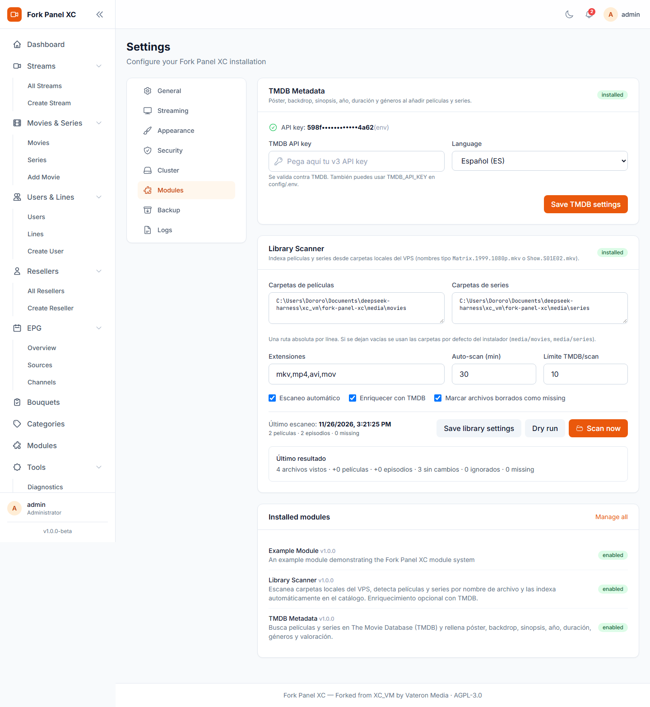

# Módulo Library Scanner — indexar películas y series desde carpetas locales

Escanea una o varias carpetas del VPS, detecta películas y episodios por el
nombre del archivo y los crea en el catálogo (tablas `streams`, `series` y
`episodes`). Opcionalmente enriquece cada título con TMDB.



## 1. Instalación

El instalador crea las carpetas y deja el módulo instalado:

```
/home/fork_panel_xc/media/movies
/home/fork_panel_xc/media/series
```

Si actualizas desde una versión anterior:

```bash
sudo -u fork_panel_xc php /home/fork_panel_xc/console.php db:migrate
sudo -u fork_panel_xc php /home/fork_panel_xc/console.php module:install library
```

También desde **Modules → Library Scanner → Install module**.

## 2. Configuración

**Settings → Modules → Library Scanner**:

| Campo | Descripción |
| --- | --- |
| Carpetas de películas | Una ruta **absoluta** por línea. Vacío = `media/movies` del instalador. |
| Carpetas de series | Una ruta absoluta por línea. Vacío = `media/series`. |
| Extensiones | `mkv,mp4,avi,mov,m4v,webm,ts,mpg,mpeg` por defecto. |
| Auto-scan (min) | Cada cuánto escanea el scheduler (mínimo 5). |
| Límite TMDB/scan | Máximo de búsquedas a TMDB por ejecución (0 = sin enriquecimiento). |
| Escaneo automático | Activa el escaneo periódico desde `schedule:daemon`. |
| Enriquecer con TMDB | Usa el módulo TMDB (requiere API key configurada). |
| Marcar archivos borrados como missing | Marca en `library_files` lo que ya no existe (no borra streams/episodios). |

Los cambios se guardan con **Save library settings**. El escaneo manual usa
**Scan now** (real) o **Dry run** (no escribe nada).

## 3. Nombres de archivo reconocidos

Películas:

```
Matrix.1999.1080p.BluRay.x264.mkv     → Matrix (1999)
Inception (2010) 720p.mp4             → Inception (2010)
El Padrino [1972] 4K.mkv              → El Padrino (1972)
```

Series (la carpeta de la temporada se ignora; el nombre de la serie se toma del
nombre del archivo antes de `SxxEyy` o de la carpeta padre):

```
Breaking Bad/Season 01/Breaking.Bad.S01E01.1080p.mkv
Lost/Season 02/Lost - 2x05 - ...and Found.mkv
```

Se ignoran archivos sin patrón de episodio y extensiones no configuradas.

## 4. Ejecución

- **Manual UI:** Settings → Modules → Library Scanner → Scan now.
- **CLI:**

  ```bash
  sudo -u fork_panel_xc php /home/fork_panel_xc/console.php library:scan
  sudo -u fork_panel_xc php /home/fork_panel_xc/console.php library:scan --dry-run
  sudo -u fork_panel_xc php /home/fork_panel_xc/console.php library:scan --limit=100
  ```

- **Automático:** `fork-panel-xc-scheduler` llama a `LibraryScanner::runIfDue()`
  cada minuto y escanea si `auto_enabled=1` y pasó `scan_interval_minutes` desde
  `last_scan_at`. También se ejecuta desde `console.php schedule:run` (cron).

Cada archivo queda registrado en `library_files` (único por `sha1(ruta)`), con
tamaño, mtime, ids de destino y estado (`indexed`, `missing`, `error`). Un
segundo escaneo omite los archivos sin cambios (skip).

## 5. Enriquecimiento TMDB

Con el módulo TMDB habilitado y su API key configurada:

- Películas: busca por título+año, importa póster, backdrop, sinopsis, rating,
  duración, géneros y `tmdb_id`.
- Series: busca la serie una sola vez por nombre (`tv`), importa portada,
  sinopsis, rating, géneros y fecha de estreno.
- Límite por ejecución (`enrich_limit`) para no agotar la cuota; las respuestas
  de TMDB se cachean 24 h.
- Sin TMDB, se indexa solo con el título/año deducidos del nombre.

## 6. API del módulo

Solo administradores. Rutas activas solo si el módulo está habilitado.

| Método | Ruta | Descripción |
| --- | --- | --- |
| `GET` | `/api/library/settings` | Configuración, stats y último reporte |
| `PUT` | `/api/library/settings` | Guarda carpetas/opciones (valida directorios) |
| `GET` | `/api/library/status` | Stats, último reporte y últimos 20 archivos |
| `POST` | `/api/library/scan` | `{"dry_run":true,"limit":0}` |

Ejemplo:

```bash
TOKEN=$(curl -s -X POST http://127.0.0.1/api/auth/login \
  -H 'Content-Type: application/json' \
  -d '{"username":"admin","password":"…"}' | jq -r .access_token)

curl -s -X POST http://127.0.0.1/api/library/scan \
  -H "Authorization: Bearer $TOKEN" -H 'Content-Type: application/json' \
  -d '{"dry_run":true}'
```

## 7. Qué crea exactamente

- Película → `streams` con `stream_type='movie'`, `stream_source='file:///ruta'`.
- Serie → `series` (una por nombre; TMDB id/portada si se enriquece).
- Episodio → `episodes` con `season_num`, `episode_num`, `title`, `source='file://…'`.
- Registro de auditoría → `library_files`.

**Duplicados:** si ya existe un stream con la misma ruta o mismo título+año, se
reutiliza y se actualiza su metadata. Si ese stream tenía una fuente HTTP manual,
**se conserva la URL** y solo se enlaza al archivo local.

**Borrados:** al desaparecer un archivo, la siguiente pasada completa lo marca
`missing`; no elimina el stream/episodio (evita pérdidas accidentales).

## 8. Limitaciones actuales

- Las fuentes locales se guardan como `file://…`. El endpoint de streaming solo
  redirige `http/https`, así que estos títulos quedan catalogados pero no se
  sirven por HTTP todavía. Para reproducirlos hace falta un endpoint de archivos
  locales o publicarlos con nginx/ffmpeg (siguiente fase).
- El escaneo es síncrono. Bibliotecas muy grandes conviene lanzarlas por CLI
  (sin límite de tiempo) o con `--limit` por tandas.
- No lee metadatos embebidos (MKV/MP4 tags); solo nombre de archivo + TMDB.
- Sigue enlaces simbólicos solo si el recorrido del sistema los resuelve; no hay
  protección específica contra bucles de symlinks.

## 9. Solución de problemas

| Síntoma | Solución |
| --- | --- |
| `Permiso denegado` al escanear | El usuario `fork_panel_xc` debe poder leer las carpetas (`chmod -R a+rX` o grupo adecuado). |
| `Folder not readable` | Ruta inexistente o sin permisos; revisa con `sudo -u fork_panel_xc ls -la`. |
| No detecta episodios | El nombre debe incluir `S01E02` o `1x02`; revisa la carpeta padre. |
| Todo se marca `missing` | Alguna ruta configurada ya no existe o está vacía; corrige las carpetas antes de un scan completo. |
| Sin póster/sinopsis | TMDB no configurado o `enrich_tmdb=0`; revisa **Settings → Streaming → TMDB**. |
| 404 en `/api/library/*` | Módulo deshabilitado: `console.php module:install library` y comprueba `module:list`. |

## 10. Desinstalar

```bash
sudo -u fork_panel_xc php /home/fork_panel_xc/console.php module:uninstall library
```

Los streams/series/episodios ya indexados permanecen; solo se deja de escanear.
