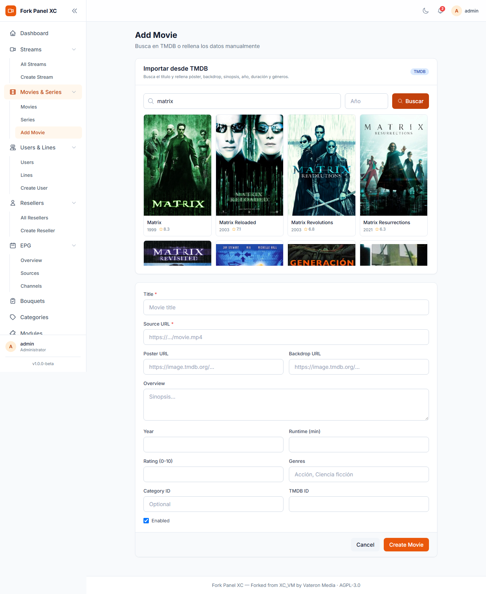

# Módulo TMDB — metadatos para películas y series

El módulo `tmdb` consulta [The Movie Database](https://www.themoviedb.org/) y
rellena, desde el formulario de alta:

- título y título original
- sinopsis
- póster (`w500`) y backdrop (`w1280`)
- año / fecha de estreno
- duración, géneros y valoración
- `tmdb_id` para futuras actualizaciones



## 1. Instalar el módulo

Desde el panel: **Modules → TMDB Metadata → Install module**.

O por terminal:

```bash
sudo -u fork_panel_xc php /home/fork_panel_xc/console.php module:install tmdb
sudo -u fork_panel_xc php /home/fork_panel_xc/console.php module:list
```

El instalador (`install.sh`) ya lo instala automáticamente y aplica la migración
`003_tmdb_metadata.sql`. En una instalación existente, vuelve a ejecutar el
instalador (con rebuild del frontend) o aplica la migración a mano:

```bash
sudo -u fork_panel_xc php /home/fork_panel_xc/console.php db:migrate
```

## 2. Configurar la API key

**Opción A — panel (recomendada):** *Settings → Modules → TMDB Metadata*.
Pega la key v3, elige idioma y guarda. Se valida contra TMDB antes de guardarse
y queda en la tabla `settings` (sección `tmdb`).

**Opción B — entorno:** añade a `config/.env`:

```env
TMDB_API_KEY=tu_api_key_v3
```

**Opción C — instalador:**

```bash
sudo bash install.sh --tmdb-api-key 'tu_api_key_v3'
```

La key del entorno tiene prioridad sobre la de base de datos. En el panel solo
se muestra enmascarada (`598f••••••••4a62`).

> Consigue una key gratuita en themoviedb.org → *Settings → API*. No subas la
> key al repositorio: `config/.env` está ignorado por git.

## 3. Uso

1. **Movies → Add Movie** o **Series → Add Series**.
2. Escribe el título en *Importar desde TMDB* y pulsa **Buscar**.
3. Elige el resultado correcto (el año y la valoración ayudan a desambiguar).
4. El formulario se rellena; añade la **Source URL** del archivo/stream y guarda.

La imagen queda referenciada por URL de TMDB; no se descarga al servidor. Si
prefieres alojarla localmente, usa el módulo de imágenes/caché del panel.

## 4. API del módulo

Todas las rutas requieren sesión de administrador (o permiso `tmdb.use`) y solo
existen mientras el módulo está **instalado y habilitado**.

| Método | Ruta | Descripción |
| --- | --- | --- |
| `GET` | `/api/tmdb/search?query=matrix&type=movie&year=1999` | Busca películas (`movie`) o series (`tv`) |
| `GET` | `/api/tmdb/details/{type}/{id}` | Detalle con géneros, duración, tagline y temporadas |
| `GET` | `/api/tmdb/settings` | Estado de la key (enmascarada) e idioma |
| `PUT` | `/api/tmdb/settings` | Guarda y valida `api_key` y/o `language` |

Ejemplo:

```bash
TOKEN=$(curl -s -X POST http://127.0.0.1/api/auth/login \
  -H 'Content-Type: application/json' \
  -d '{"username":"admin","password":"…"}' | jq -r .access_token)

curl -s "http://127.0.0.1/api/tmdb/search?query=matrix&type=movie" \
  -H "Authorization: Bearer $TOKEN"
```

## 5. Caché

Las respuestas se guardan 24 h en `storage/cache/tmdb/<sha1>.json`. Borrar esa
carpeta (o *Tools → Cache → Clear*) fuerza una consulta nueva. Si el directorio
no es escribible se sigue funcionando sin caché.

## 6. Solución de problemas

| Síntoma | Causa / solución |
| --- | --- |
| No aparece la tarjeta TMDB | Módulo no instalado: `module:install tmdb`. |
| `422 TMDB API key is not configured` | Configura la key en Settings → Modules o `TMDB_API_KEY`. |
| `502 TMDB request failed: SSL certificate…` | Falta el bundle de CA en PHP (`curl.cainfo`/`openssl.cafile`). En Ubuntu/Debian instala `ca-certificates`. |
| `502 TMDB rejected the API key` | Key inválida o revocada. |
| Las rutas `/api/tmdb/*` dan 404 | Módulo deshabilitado o tabla `modules` sin la fila `tmdb`. |

## 7. Desinstalar

```bash
sudo -u fork_panel_xc php /home/fork_panel_xc/console.php module:uninstall tmdb
```

Las columnas de metadatos (`overview`, `backdrop`, `rating`, `runtime`,
`genres`, `original_title`) permanecen en la base de datos; el módulo solo deja
de ofrecer búsqueda e importación.
